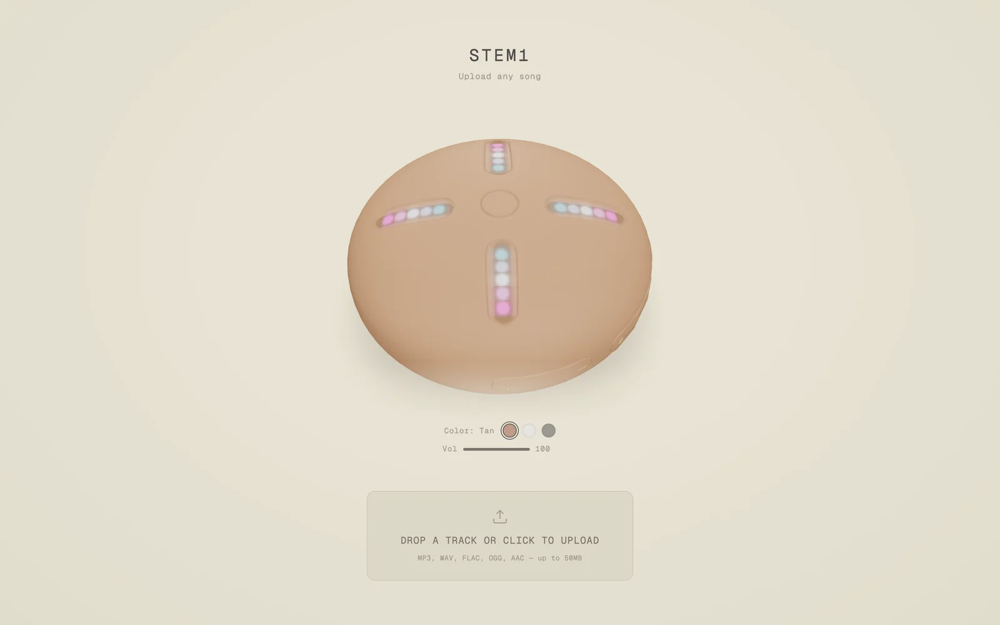

# Stem Player

Kanye's Stem Player, right in the browser. Upload a song, it gets split into stems, and you mix them on a 3D model of the device.



## Features

- Splits any song into vocals, drums, bass and everything else using Demucs
- Upload a file or paste a YouTube link
- Drag along the LED grooves to turn each stem up or down while it plays
- Echo, reverb and filter effects, plus a speed control
- Record your mix
- Keyboard shortcuts and three colourways

## How it works

The browser uploads the song straight to Cloudflare R2 with a presigned URL. A Worker then starts a Modal job, which runs Demucs on a GPU and sends the four stems back to a webhook. Job status is kept in Workers KV and the page polls it until the stems are ready. After that, playback and mixing happen client-side with the Web Audio API.

## Stack

vinext (Next.js App Router on Vite), Cloudflare Workers, R2, Workers KV, Modal, Demucs, Three.js, React Three Fiber, Web Audio, Zustand, Tailwind v4.

## Running locally

You'll need Node 22, pnpm, a Cloudflare account with the R2 bucket and KV namespace from `wrangler.jsonc`, and a Modal account.

```sh
pnpm install
cp .dev.vars.example .dev.vars
pnpm dev
```

Put your R2 keys and a webhook secret in `.dev.vars`. In production those are Worker secrets (`wrangler secret put`). The Modal job reads its R2 credentials from a Modal secret called `r2-creds`.

Modal can't reach localhost when it's done, so to actually split a song locally you need a tunnel, or you can test against the deployed Worker.

To deploy:

```sh
modal deploy modal/app.py
pnpm run deploy
```

Other scripts: `pnpm typecheck`, `pnpm lint`, `pnpm format`.
